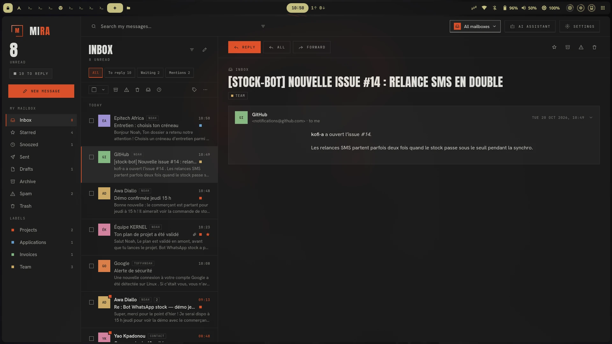
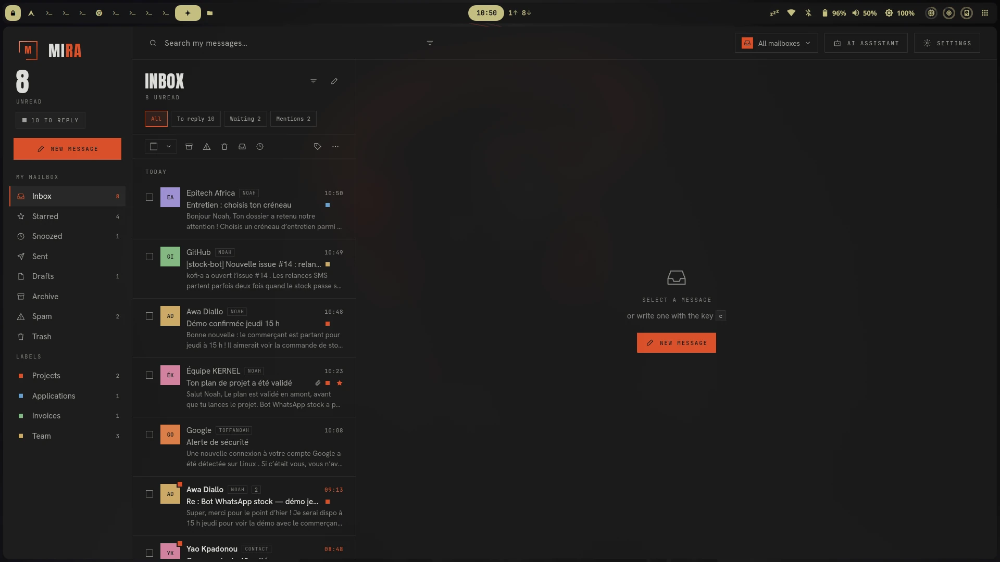
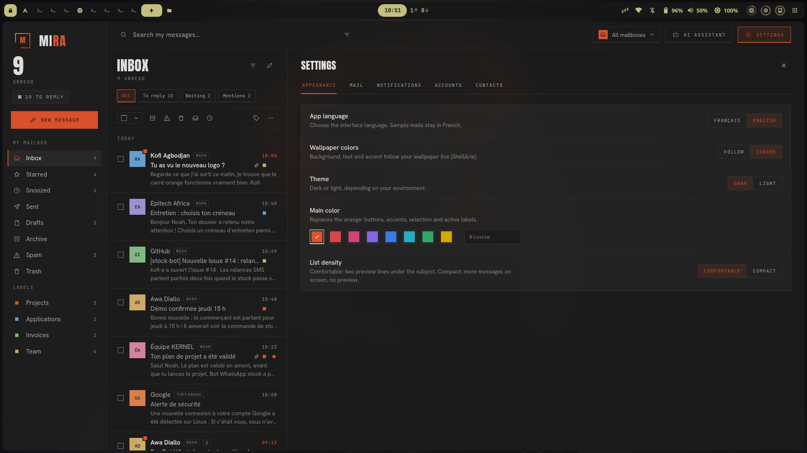

<p align="center">
  
</p>

<h1 align="center">MIRA</h1>

<p align="center"><strong>MIRA reads and sends your mail, on Linux and on Android.</strong></p>

<p align="center">Free, open source, and a bit nicer to look at than the usual mail client.</p>

<p align="center">
  <a href="https://toffanoah.com/en/mira">Website</a> ·
  <a href="https://github.com/nnoah29/MIRA/releases/latest">Download</a> ·
  <a href="docs/ENGINE.md">Build it</a>
</p>

<p align="center">
  
</p>

## Why I made it

I looked for a mail client on Linux and none of them appealed to me: too austere, paid, or stuck in a browser. So I made the one I wanted to use. Big headlines, square corners, one bright colour, and your mail on your own machine.

## What you get

- **Looks like something.** A dark theme with real character, or a light one. Pick your own accent colour, or let MIRA take the colours of your wallpaper. English and French.
- **All your accounts in one place.** Gmail, Outlook / Microsoft 365, Yahoo or any IMAP/SMTP server, with a unified inbox if you want one.
- **Works offline.** Your mail is copied to your device. Read, reply, archive and sort on a train or a plane; everything goes out when the network is back.
- **Private by default.** There is no MIRA server and no telemetry. Remote images and trackers stay blocked until you allow them.
- **Fast.** Messages open the moment you click, with no spinners.

<p align="center">
  
</p>

### Day to day

- **Read:** conversations grouped by thread, a built-in viewer for PDFs and images, one-click unsubscribe from mailing lists.
- **Write:** drafts saved as you type, undo send, scheduled sending, several sender identities with their own signature, address suggestions.
- **Organise:** archive, trash, spam and labels, snooze, stars. Labels are local: they work across all your accounts and are never sent to the server.
- **Find:** full-text search with filters (unread, starred, attachments, sender, period, account, label). Extend a search to the server, or fetch older mail, when you need to.
- **Stay in control:** a clear status when you're offline or a sync fails, pending changes you can retry or cancel, a choice of which folders to sync, keyboard shortcuts.

<p align="center">
  
</p>

> **NB:** following your wallpaper colours is a Linux-only option and needs [ShellArie](https://github.com/Arch-Noah/ShellArie), my Quickshell shell for Hyprland. MIRA reads the colours ShellArie extracts from your wallpaper and updates live. Without ShellArie, or on Android, the option does nothing: pick an accent colour in the settings instead. Everything else in MIRA works without it.

## Install

**Linux, no sudo** (installs and updates):

```bash
curl -fsSL https://github.com/nnoah29/MIRA/releases/latest/download/install.sh | bash
```

Or take a package from the [latest release](https://github.com/nnoah29/MIRA/releases/latest): `.deb` (Debian, Ubuntu, Mint), `.rpm` (Fedora, openSUSE), AppImage (any distribution) or a `.tar.gz`.

**Android 7 and later:** download the `.apk` from the same release.

Linux needs glibc 2.34 or newer (Ubuntu 22.04, Debian 12, Fedora 35 and later) and GTK 3. To store your passwords, use a keyring such as GNOME Keyring or KWallet. Checksums are published with each release.

## Try it without an account

MIRA can run on sample data, with nothing sent anywhere:

```bash
cd app
MIRA_DEMO=1 flutter run -d linux
```

## Supported accounts

| Provider | Sign-in |
| --- | --- |
| Gmail | Google sign-in |
| Outlook, Microsoft 365 | Microsoft sign-in |
| Yahoo | App password |
| Any IMAP/SMTP account | Server and password |

## For developers

MIRA is a Rust engine (`engine/`) with a Flutter interface (`app/`). Building and contributing: see [`docs/ENGINE.md`](docs/ENGINE.md) and [`app/README.md`](app/README.md).

## License

MIRA is released under the [MIT License](LICENSE).
